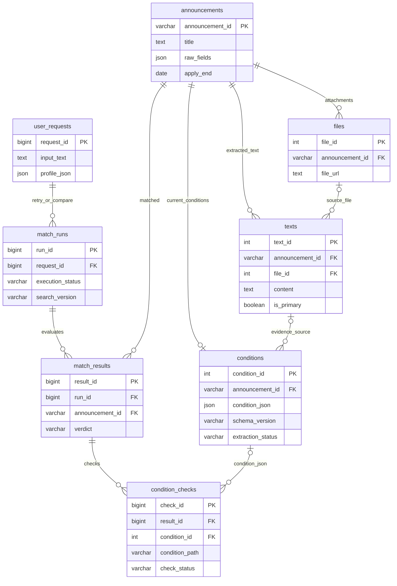

> ⚠️ **구 통합 설계 문서입니다.** 이 ZIP에는 8개 테이블을 구현한 코드와 로컬 검색 데모가 추가되었습니다. 현재 실제 상태는 [IMPLEMENTED_V2.md](IMPLEMENTED_V2.md)를 우선 참고하세요.

# 통합 ERD v2 — 프론트 × AI × DB

> 설계안. ERDCloud의 기존 프로젝트를 **복제 후 수정**하는 것을 권장합니다. 현행 SQLite DB는 4개 테이블이며 추가 테이블은 아직 미구현.

## 데이터 흐름

1. 공고 API → `announcements`, `files`
2. PDF/HWP/HTML 추출 → `texts` (현재 대표 텍스트 307건, 35건 실패/누락 상태 관리)
3. AI 신청자격 추출 → `conditions.condition_json` (원형 v0.4 + 필터 보조 컬럼)
4. 사용자가 자연어 입력 → `POST /api/support-match` → `user_requests` (저장 필요할 때만)
5. 사용자 프로필 추출 → RAG 검색 → 판정 → `match_runs` (실험/재현 선택)
6. 공고별 🟢🟡🔴⚪ 결과 → `match_results` 및 개별 조건 → `condition_checks` (저장 필요할 때만)
7. API가 필요한 데이터를 JSON으로 조합하여 React에 응답. **테이블 1개 = 화면 1개가 아닙니다.**

## 주의 및 논의사항

- 현재 `texts`는 1:0..1 구조이며 이 그림은 **향후 변경할 1:N** 구조. 실제 코드는 아직 변경되지 않았습니다.
- `files.file_id` ↔ `texts.file_id`는 선택적 관계: HTML 원문/통합 원문은 file_id가 NULL일 수 있습니다.
- `conditions` JSON 내부 대안조건/트랙은 독립 행으로 강제 분해하지 않습니다.
- 상세 화면은 현재 React Router `location.state.result`에 의존하며 직접 URL 접속/새로고침 시 실패할 수 있습니다. API 연결 방식을 설계해야 합니다.
- `POST /api/support-match`는 현재 AI 미연동으로 HTTP 409를 반환합니다. 위 흐름은 **목표 아키텍처**입니다.

## 확장 테이블

- `extraction_runs`: AI 추출 비교·버전 이력
- `notice_chunks`: RAG 인덱스와 공고·원문 연결 (RAG팀의 파일 인덱스 방식과 중복 여부 확인)
- `excluded_industries`: 표준 제외업종 CSV를 서버가 직접 조회할 때
- `eval_labels`: 정답 라벨을 DB에서 관리할 때
